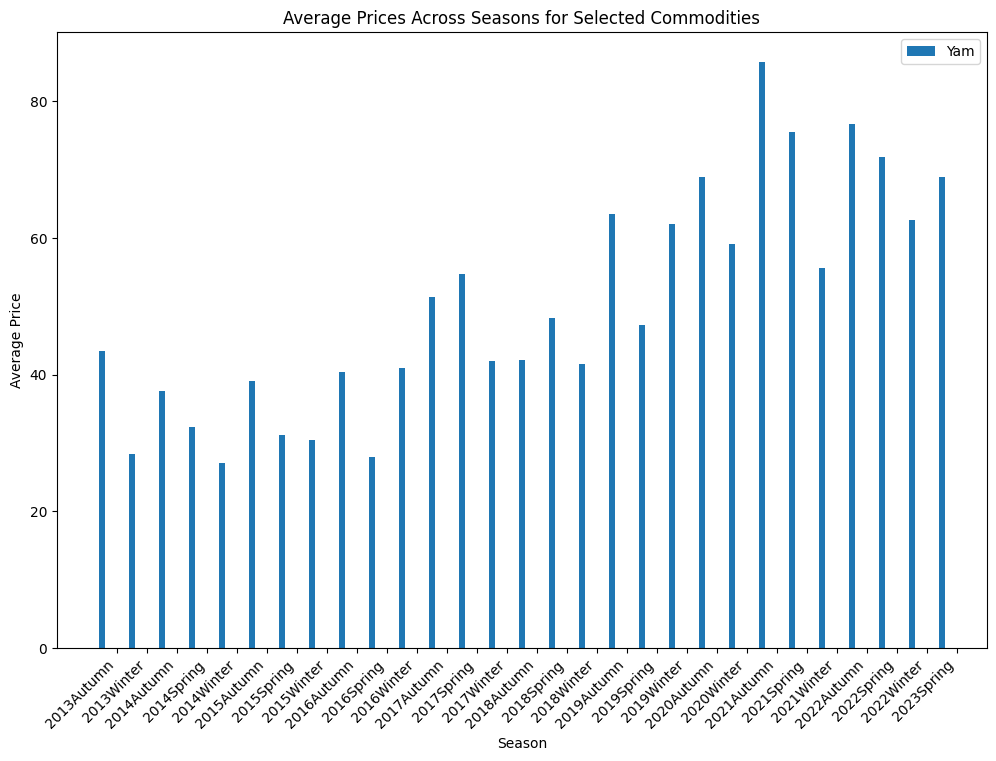

# Nepal Agricultural Commodity Price Analysis

Exploratory analysis of wholesale fruit and vegetable prices from Nepal's Kalimati market, 2013 to 2023. The project cleans and merges two public price datasets, builds a seasonal view of prices for 136 commodities, and visualises long-term and seasonal price trends.

Big Data coursework, BSc (Hons) Computer Science, Herald College Kathmandu (University of Wolverhampton).

**Authors:** Nishan Jung Suwal, Bibek Bharati

## Why this project

Price volatility is a serious problem for Nepali farmers, because sudden rises and falls make it hard to plan what to plant and when to sell. This project looks at how prices of different commodities have moved over ten years and how they vary by season. The accompanying report gives the background and related work (see `report/`).

## Data

The raw CSV files are not included in this repository. Download them from the dataset page and save them in a `data/` folder using the names below.

| Dataset resource on Open Data Nepal | Save as | Period | Rows |
|---|---|---|---|
| Kalimati Tarkari Prices from June 2013 to May 2021 | `kalimati_prices_2013_2021.csv` | June 2013 to May 2021 | about 197,000 |
| Kalimati Tarkari Prices from May 2021 to September 2023 | `kalimati_prices_2021_2023.csv` | May 2021 to September 2023 | about 96,000 |

- **Source:** Kalimati Tarkari Dataset (Fruits and Vegetables Price), maintained by Nischal Lal Shrestha on Open Data Nepal: https://opendatanepal.com/dataset/kalimati-tarkari-dataset
- **Original source:** prices scraped from the Kalimati Fruits and Vegetable Market Development Board: https://kalimatimarket.gov.np/
- **Licence:** Creative Commons Attribution, as stated by Open Data Nepal. Please credit the source above if you reuse the data.
- **Fields:** commodity, date, unit, minimum price, maximum price, average price (NPR)

## What the notebook does

1. **Loads and merges** the two datasets into one table of about 294,000 records covering 136 commodities.
2. **Cleans the data:**
   - renames columns and converts dates to a proper date type
   - standardises unit labels (`kg`, `dozen`, `piece`)
   - converts price strings such as `Rs 45.00` to numbers
   - checks for missing values and duplicate rows (none found)
3. **Creates a season feature** (spring March to May, summer June to August, autumn September to November, winter December to February).
4. **Aggregates** minimum, maximum and average prices by commodity and season (3,966 commodity-season rows).
5. **Visualises** price movement, for example the price trend for watermelon and seasonal average prices for yam.

## Example finding

Yam's average autumn price rose from about Rs 43/kg in 2013 to about Rs 86/kg in 2021.


## 👥 Team Contributions

### **Bibek Bharati**
* **Data Sourcing & Collection:** Searched, gathered, and organized the historical agricultural price datasets (spanning 2013–2021 and 2021–2023) to establish the primary data foundation.
* **Data Cleaning & Standardization:** Handled messy string formats, unified divergent units (e.g., standardizing `'Rs 50.00'`, `'Kg'`, and `'kg'`), and resolved missing values to ensure data integrity.
* **Pipeline Initialization:** Built the initial ingestion and merging workflow to combine separate temporal files into a unified dataframe (`combined_df`).

### **Nishan Jung Suwal**
* **Exploratory Data Analysis (EDA):** Performed statistical aggregations to identify seasonal price spikes, track price distributions for essential commodities, and analyze market trends.
* **Volatility & Visual Analysis:** Calculated price volatility metrics (standard deviation and coefficient of variation) and generated visualizations using Seaborn and Matplotlib.
* **Report & Findings (Second Half):** Spearheaded the drafting and interpretation of the analytical findings, insights, and market/policy implications for the final project report.

## Tools

Python 3, pandas, NumPy, Matplotlib, Seaborn, scikit-learn (label encoding). Built and run in Google Colab.

## How to run

1. Clone or download this repository.
2. Download the two CSV files from the dataset page (see Data) and save them in a `data/` folder, named as shown in the table.
3. Open `notebooks/nepal_agri_price_analysis.ipynb` in Google Colab or Jupyter.
4. Update the file paths in the data loading cell to point to `../data/` instead of Google Drive.
5. Run all cells.

## Scope and limitations

- This is an exploratory analysis. It describes price trends and seasonal patterns but does not build a forecasting model.
- The report discusses climate and economic factors as possible drivers of price changes, but the notebook does not include climate or economic data. It uses prices and dates only.
- Seasons follow the calendar definition above, not Nepal's agricultural calendar.

## Repository structure

```
nepal-agri-price-analysis/
├── README.md
├── notebooks/
│   └── nepal_agri_price_analysis.ipynb
├── report/
│   └── nepal_agri_price_analysis_report.pdf
├── data/
├── images/
│   └── yam_seasonal_prices.png
└── requirements.txt
```
